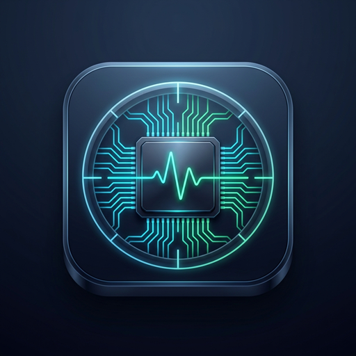

# 📱 PhoneScope (فون‌اسکوپ)

<div align="center">



### ابزار جامع و حرفه‌ای پایش سخت‌افزار، تست سلامت قطعات، بنچمارک و گزارش‌گیری اندروید
### Professional Android Hardware Diagnostics, Component Testing, Benchmarking & System Monitor

[](https://flutter.dev)
[](https://kotlinlang.org)
[-3DDC84?logo=android&logoColor=white)](https://developer.android.com)
[](#)
[](#)
[](LICENSE)

[**توضیحات فارسی**](#-درباره-برنامه-فارسی) • [**English Description**](#-about-phonescope-english) • [**ویژگی‌ها**](#-قابلیت‌های-کلیدی) • [**معماری**](#-معماری-پروژه) • [**نصب و اجرا**](#-راهنمای-بیلد-و-اجرا) • [**توسعه‌دهنده**](#-توسعهدهنده--developer)

</div>

---

## 📖 درباره برنامه (فارسی)

**PhoneScope (فون‌اسکوپ)** یک اپلیکیشن بومی و مهندسی‌شده اندروید است که برای شناسایی دقیق مشخصات فنی سخت‌افزار، مانیتورینگ لحظه‌ای منابع، تست قطعات فیزیکی، بنچمارک استاندارد و تهیه گزارش تشخیصی توسعه یافته است.

برخلاف برنامه‌های متداول که صرفاً داده‌های شبیه‌سازی‌شده یا استاتیک نمایش می‌دهند، PhoneScope بر پایه **صداقت کامل در نمایش داده‌ها** طراحی شده است؛ به این معنا که تمامی پارامترها مستقیماً از کرنل لینوکس، Android SDK و Camera2 API خوانده می‌شوند و محدودیت‌های سطوح دسترسی سیستم‌عامل (مانند محدودیت‌های SELinux در قرائت دمای مجزای هسته‌ها) به شکل شفاف به کاربر توضیح داده می‌شود.

این ابزار برای **کاربران عادی، خریداران گوشی کارکرده/دست‌دوم، تعمیرکاران موبایل و توسعه‌دهندگان** انتخابی ایده‌آل است.

---

## 🌐 About PhoneScope (English)

**PhoneScope** is a production-grade, enterprise-quality Android hardware diagnostics, benchmarking, and real-time system monitoring tool built with Flutter and Native Kotlin. It provides an honest, in-depth look under the hood of any Android device (supporting Android 7.0 Nougat through Android 15, API levels 24 to 35).

### Core Pillars
- **Zero-Telemetry & 100% Offline:** No ads, no tracking IDs, no remote analytics, and zero external network calls.
- **Data Authenticity Guarantee:** Every frequency, temperature, sensor event, and battery metric reflects real hardware readings. No mock graphs or fake values.
- **Enterprise Clean Architecture:** Robust separation of concerns (Views, ViewModels, Repositories, and Native Platform Services).

---

## ✨ قابلیت‌های کلیدی

### ۱. پایش و مشخصات جامع قطعات
- **تراشه و پردازنده (SoC & CPU):** شناسایی مدل دقیق چیپست، فرکانس زنده تک‌تک هسته‌ها، دسته‌بندی خوشه‌ای (big.LITTLE / Prime) و دستورالعمل‌های ABI.
- **پردازنده گرافیکی (GPU):** شناسایی `GL_RENDERER`، `GL_VENDOR`، نسخه OpenGL ES و اکستنشن‌های سخت‌افزاری از طریق ساخت Headless EGL Context اختصاصی در کدهای نیتیو.
- **حافظه و فضای ذخیره‌سازی (RAM & Storage):** درصد مصرف زنده رم با `ActivityManager.MemoryInfo`، حافظه تخصیص‌یافته به اپلیکیشن و حجم کل/آزاد پارتیشن‌ها با `StatFs`.
- **باتری و شارژ (Battery):** جریان لحظه‌ای بر حسب میلی‌آمپر (mA)، ولتاژ بر حسب میلی‌ولت (mV)، دمای سلول، وضعیت سلامت و تکنولوژی ساخت از طریق استریم زنده `EventChannel`.
- **وضعیت حرارتی (Thermal Monitor):** پایش وضعیت تراتلینگ پردازنده (Throttling) و Thermal Headroom با `PowerManager`.
- **صفحه‌نمایش (Display):** رزولوشن فیزیکی و منطقی، نرخ نوسازی (Hz)، تراکم پیکسلی (DPI)، استانداردهای HDR و وسعت رنگ (Wide Color Gamut).
- **دوربین‌ها (Camera):** استخراج مشخصات لنزها از طریق Camera2 API (مگاپیکسل واقعی، گشودگی دیافراگم، فاصله کانونی، لرزشگیر اپتیکال OIS و بازه ISO) بدون نیاز به اخذ مجوز دوربین.
- **سنسورها (Sensors):** فهرست جامع کلیه سنسورهای فیزیکی به همراه مانیتورینگ زنده زاویه و شتاب با لغو خودکار لیسنرها جهت حفظ باتری.
- **شبکه و ارتباطات (Network & Wi-Fi):** تشخیص سیگنال RSSI، استاندارد شبکه (Wi-Fi 4/5/6)، فرکانس باند (2.4/5GHz) و IPv4 محلی.
- **برنامه‌های نصب‌شده (Installed Apps):** بررسی پکیج‌ها، Target SDK، حجم و مجوزهای اعلام‌شده.

### ۲. جعبه‌ابزار تست سخت‌افزار (Interactive Hardware Tests)
- **تست پیکسل سوخته (Screen Dead-Pixel Test):** چرخه ۵ رنگ تمام‌صفحه با مخفی‌سازی نوارهای سیستم برای کشف هاله، برن‌این و پیکسل‌های مرده.
- **تست تاچ چندگانه (Multi-touch Matrix):** تست هم‌زمان نقاط لمس، نمایش مختصات لحظه‌ای و سنجش پاسخگویی تاچ.
- **تست بلندگو و میکروفون (Audio & Mic Test):** تولید موج صوتی فرکانس خالص (Pure Sine Wave) و سنجش دامنه صدای میکروفون با تحلیلگر RMS زنده.
- **تست لرزش (Vibration Patterns):** اجرای الگوهای ویبره کوتاه، دوبل و کد مورس SOS با `VibrationEffect`.
- **تست فلاش دوربین (Torch Test):** سوئیچ سریع فلاش LED پشت دستگاه.

### ۳. ماژول بنچمارک استاندارد (Transparent Benchmarking)
- **بنچمارک تک‌هسته‌ای و چندهسته‌ای CPU:** اجرای موازی محاسبات سنگین با الگوریتم رمزنگاری SHA-256 در بستر چندرشته‌ای `Isolate`های دارت بدون فریز شدن UI.
- **بنچمارک سرعت خواندن و نوشتن حافظه داخلی:** تست ترتیبی I/O با تولید بلاک ۱۶ مگابایتی و پاکسازی کامل داده‌های موقت پس از اتمام بنچمارک.

### ۴. ابزارهای تکمیلی و خروجی
- **چک‌لیست خرید گوشی دست‌دوم:** راهنمای گام‌به‌گام بررسی بدنه، ریجستری، پورت‌ها، سنسورها و سلامت قطعات برای خریداران و فروشندگان.
- **تشخیص ناهنجاری سیستمی (Anomaly Detection):** راستی‌آزمایی مشخصات ادعایی دستگاه، شناسایی ردپای روت و بیلد با کلیدهای آزمایشی (test-keys).
- **تولید گزارش تشخیصی:** خروجی گرفتن در قالب‌های متنی (TXT)، ساختاریافته (JSON) و سند رسمی (PDF) همراه با قابلیت اشتراک‌گذاری در پیام‌رسان‌ها.
- **واژه‌نامه تخصصی:** توضیح ساده و روان مفاهیم پیچیده سخت‌افزاری برای ارتقای دانش فنی کاربران.

---

## 🏗️ معماری پروژه

پروژه بر مبنای اصول تفکیک مسئولیت‌ها (Separation of Concerns) و معماری لایه‌ای پیاده‌سازی شده است:

```
PhoneScope/
├── android/app/src/main/kotlin/com/phonescope/phonescope/
│   ├── MainActivity.kt                  # ثبت و مدیریت Platform Channels
│   └── channels/                        # ۱۳ هندلر مستقل بومی Kotlin
│       ├── SystemInfoHandler.kt         # مشخصات کرنل و سیستم
│       ├── CpuInfoHandler.kt            # فرکانس‌های sysfs و procfs
│       ├── GpuInfoHandler.kt            # رندرینگ هدلس EGL و OpenGL
│       ├── MemoryStorageHandler.kt      # ActivityManager و StatFs
│       ├── BatteryHandler.kt            # EventChannel پایش باتری
│       ├── ThermalHandler.kt            # سازگار با Android 7 تا 15
│       ├── DisplayInfoHandler.kt        # DisplayMetrics و HDR
│       ├── CameraInfoHandler.kt         # CameraCharacteristics
│       ├── SensorsHandler.kt            # استریم زنده سنسورها
│       ├── NetworkInfoHandler.kt        # Wi-Fi و NetworkCapabilities
│       ├── AppsInfoHandler.kt           # اطلاعات پکیج‌های نصب‌شده
│       ├── HardwareTestHandler.kt       # فلاش، ویبره، صوت و میکروفون
│       └── ShareHandler.kt              # اینتنت‌ها، FileProvider و باز کردن لینک‌ها
├── lib/
│   ├── app/                             # تم متریال ۳، تایپوگرافی، فونت وزیرمتن
│   ├── core/                            # کلاینت متمرکز Platform Channels و ویجت‌های پایه
│   └── features/                        # ماژول‌های مستقل هر بخش (Feature-First)
│       ├── dashboard/                   # داشبورد اصلی
│       ├── device/                      # دسته‌بندی مشخصات قطعات
│       ├── hardware_tests/              # تست‌های تعاملی سخت‌افزار
│       ├── benchmarks/                  # موتور بنچمارک با Isolate
│       ├── reports/                     # سرویس گزارش‌گیری TXT/JSON/PDF
│       ├── tools/                       # چک‌لیست گوشی دست‌دوم
│       └── settings/                    # شخصی‌سازی، مشخصات سازنده و حریم خصوصی
└── assets/
    ├── fonts/                           # فونت محلی Vazirmatn (بدون نیاز به اینترنت)
    └── icons/                           # لوگو و آیکون رسمی اپلیکیشن
```

---

## 🚀 راهنمای بیلد و اجرا

### پیش‌نیازها
- **Flutter SDK:** نسخه 3.24 یا بالاتر (تست‌شده روی Flutter 3.47)
- **Dart SDK:** نسخه 3.5 یا بالاتر
- **Android SDK:** حداقل API 24 (اندروید 7.0)، هدف API 35 (اندروید 15)
- **Java / JDK:** نسخه 17

### ۱. دریافت وابستگی‌ها
```bash
flutter pub get
```

### ۲. اجرای آزمون‌های خودکار
```bash
flutter test
```

### ۳. بررسی سلامت کد (Linting)
```bash
flutter analyze
```

### ۴. اجرای زنده روی دستگاه متصل
```bash
flutter run --release
```

### ۵. بیلد نسخه خروجی چندتکه برای استورها (Split-per-ABI)
جهت کاهش حجم فایل نصبی کاربران از ۵۳ مگابایت به **حدود ۲۰ مگابایت**:
```bash
flutter build apk --release --split-per-abi
```
خروجی‌ها در مسیر زیر قرار می‌گیرند:
- `build/app/outputs/flutter-apk/app-arm64-v8a-release.apk` (مخصوص بیش از ۸۵٪ گوشی‌های مدرن)
- `build/app/outputs/flutter-apk/app-armeabi-v7a-release.apk` (مخصوص گوشی‌های ۳۲ بیتی قدیمی)

---

## 👨‍💻 توسعه‌دهنده / Developer

طراحی، معماری و پیاده‌سازی شده توسط:

### **شایان نماینده (Shayan Namayandeh)**
- 🌐 **وب‌سایت شخصی:** [devshayan.ir](https://devshayan.ir)
- 🐙 **گیت‌هاب:** [@roseshayan](https://github.com/roseshayan)
- 📧 **ایمیل:** [namayandeshayan@gmail.com](mailto:namayandeshayan@gmail.com)

---

## 📄 مجوز و حقوق نشر (License)

این پروژه تحت مجوز [MIT License](LICENSE) منتشر شده است.
فونت فارسی **وزیرمتن (Vazirmatn)** اثر صابر راستی‌کردار تحت مجوز آزاد [OFL (SIL Open Font License)](http://scripts.sil.org/OFL) استفاده شده است.
